# Product-Sales-Performance-over-time


## Project Overview
This project analyzes Product sales data to understand revenue distribution across different State and products. The focus is on identifying how shipment delays affect total returns, comparing sales contributions in state across Years, months, and weeks and examining the factors driving these differences. Population density and urbanization.

Additionally, the project explores product-level sales trends, identifying the best-selling products across state examining factor droving it such as rating, seasonal trendy outfit etc. and how some products are the top performing product but steadly are the most returned product across state. Understanding these patterns provides valuable insights into consumer purchasing behavior and market trends.

By leveraging data analysis and visualization, this project offers a comprehensive view of how sales are distributed across locations and product categories, helping businesses and stakeholders make informed decisions.

## Data Source
The data set used for ths project is gotten from kaggle 

## Problem Statement

**Product Sales Problem Statement**
-Which are the top 10 best-selling products based on total sales revenue, and what are their average customer ratings, return rates, and return categories? how do customer ratings and product returns relate to their sales performance and ranking among the top 10 products?
- Which are the top 5 most-returned products based on total return volume, what are their associated delivery-delay risks, and how does delivery delay influence the likelihood of these products being returned?
- What are the month-over-month (MoM) growth rates in total sales revenue, profit, and order volume, and how have these key business performance indicators changed over state?
- What is the average shipping delay (in days), and how does it compare between orders classified as having a delivery delay risk (Yes) and those without a delay risk (No)?

**Performance over time**
- How have sales performed over time, what is the average monthly sales revenue, and what are the month-over-month (MoM) sales growth rates?
- How have product returns changed over time, what is the average monthly return volume, and which months recorded the highest and lowest returns?
- How does sales performance vary across states over time, and what are the month-over-month (MoM) sales growth rates for each state?
- How does sales performance vary across the days of the week, and which day contributes the highest proportion of total sales revenue?

## Tools
- MySQL
- Python
- Power Bi

## Skills Demonstrated

- Data Cleaning
- Exploratory data analysis
- Python data visulaization
     - Seaborn
     - Matplotlip.pyplot
     - Plotly.express
- Object orientated peograming system (Abstraction & Inheritance
- Pandas
- Entity Relationship Daiagram
- Data Analysis
  - Common Table Expression
  - Aggreate, Text, Windows function
  - Subquery
  - Case Statement
  - Triggers
- Data Modelling
- Visualization
   - tooltip
   - DAX
   - Quick Measure
   - filters
   - Page Navigation
   - Bookmark Navigation

## Data Cleaning

I used the data cleaning library i created to converted data types to ensure consistency, rename columns to SQL Standard format for the analysis, removed unnecessary columns to reduce redundancy.

**Data cleaning in python Using the resuable data cleaning library I created)**

Renaming Column                            |                         Converting data sype
:-----------------------------------------:|:------------------------------------------:
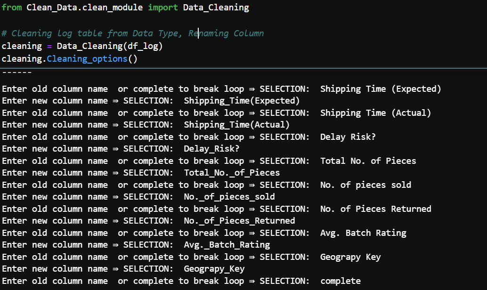                |         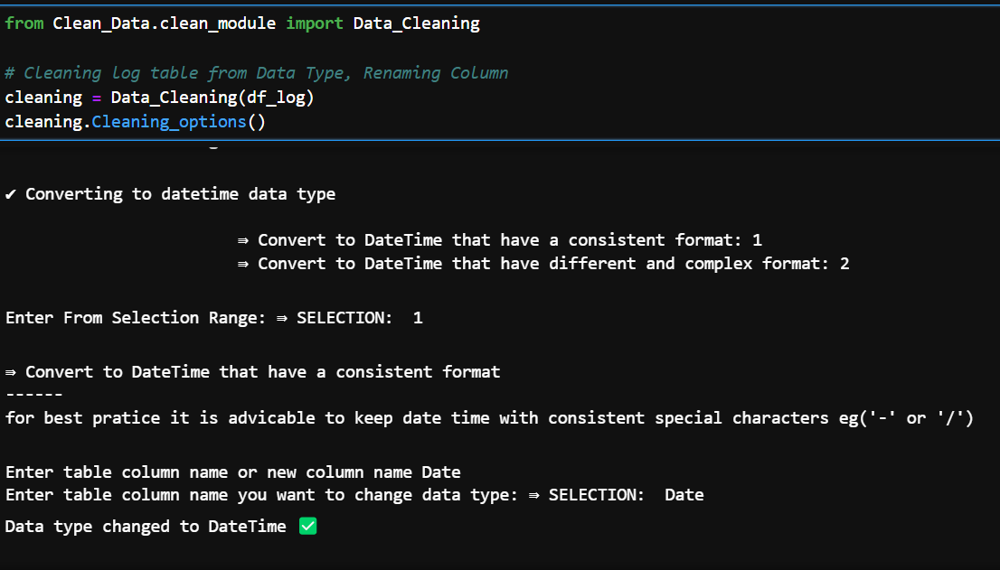


**Data cleaning in MySQL**

```sql
-- Filling missing values
UPDATE product
SET Product_Link = "https://www.pngkey.com/png/detail/80-801028_langham-30mm-black-belt-png-image-british-belt.png"
WHERE Product_ID = 'P013';
```

## Exploratory Data Analysis
### I Used sns.histplot to determine how spread out total sales are 

**REPORT: Total Sales Data is Right Skwed , it has more or peak data point at the left then a long tail at the right, With it mean(33076.77) greater than the median(29190.0) it deduced that there is significant lower sales and a fewer very high sales**
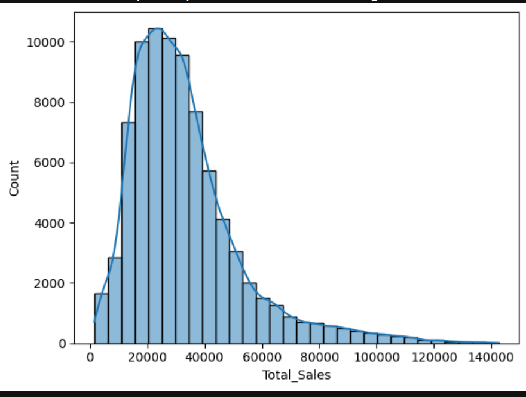  


### I used BOX plot to summarized the distribution of sales in different states category

**REPORT: The mean or 50% percentile falls between 30000 total sales and a significate amount of possible outlier that shows the histogram distribution to be right skewed**
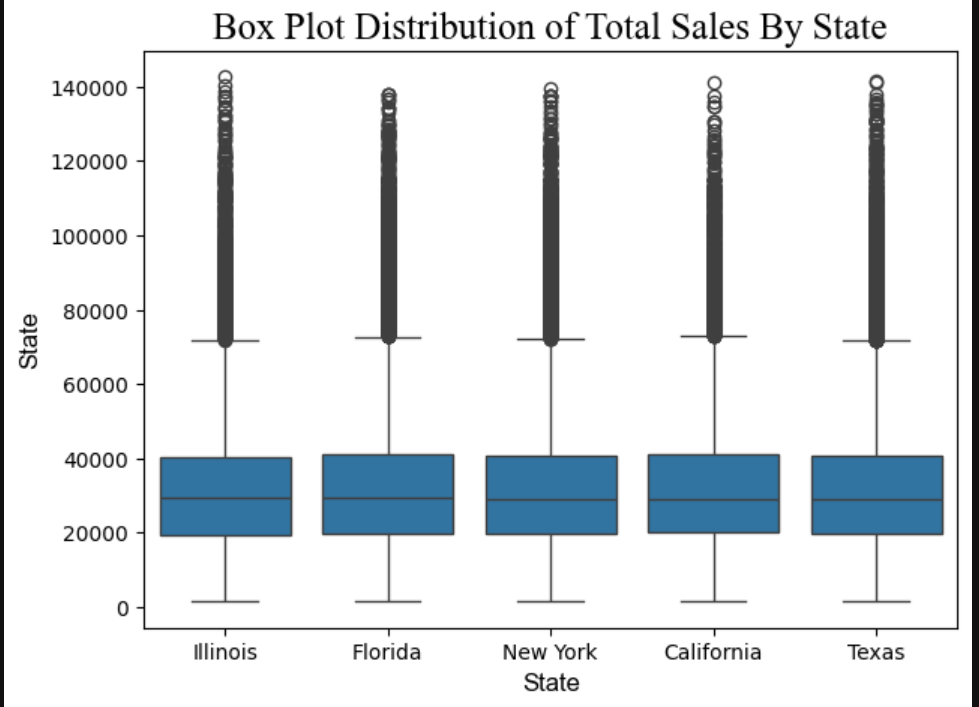 

**_TRYING TO DETERMINE IF OUTLIERS ARE TRUE OUTLIERS AND DOESNT NEED TO BE ELIMINATED_**
```
df["Possible_Outier"] = df["Total_No._of_Pieces"] - df["No._of_pieces_sold"]
df.loc[df["Possible_Outier"] < 0]

"REPORT: It is a True Outlier, The States has true higher sales this may be influenced by promotion, or holiday events"
```


### I used heatmap to determine correlation strength between numeric variable 

REPORT : The Higher the total number of piece sold the higher the profit and total sales.

         : There is no significant correlation between total piece return to No. of pieces sold and avg rating, which means product returned
           is not caused base on how many of the product they buy or rating of this product.
           
         : There is a correlation between weight of the product and selling price, base on the fact that the product is clothing, it can be 
           dedued that the greater the weight of the cloth the more quality and colthing it is hence the higher price.
           
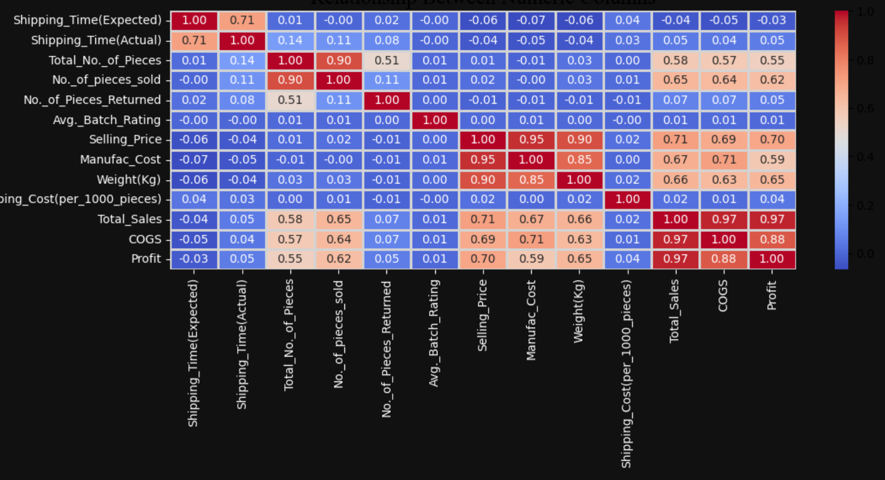 

## Entity Relationship Diagram
I added primary key constraint to uniquely identify records in product, warehouse, and geography table. then added foreign keys to sales table to create a star schema relationship across tables  
```
# ADDING PRIMARY KEY TO GEOGRAPHY TABLE
ALTER TABLE geography
ADD PRIMARY KEY (GeographyKey);

# ADDING PRIMARY KEY TO PRODUCT TABLE
ALTER TABLE product
MODIFY COLUMN Product_ID varchar(10);
ALTER TABLE product
ADD PRIMARY KEY (Product_ID);

# ADDING PRIMARY KEY TO WAREHOUSE TABLE
ALTER TABLE ware_house
MODIFY COLUMN Warehouse_ID varchar(10);
ALTER TABLE ware_house
ADD PRIMARY KEY (Warehouse_ID);

#ADDING FOREIGN KEY TO SALES LOG TABLE
ALTER TABLE sales_log
MODIFY COLUMN Product_ID varchar(10);
ALTER TABLE sales_log
ADD CONSTRAINT product_sale
FOREIGN KEY (Product_ID)
REFERENCES product (Product_ID);

ALTER TABLE sales_log
MODIFY COLUMN `Dest. Warehouse` Varchar(10);
ALTER TABLE sales_log
ADD CONSTRAINT sales_wareH
FOREIGN KEY (`Dest. Warehouse`)
REFERENCES ware_house (Warehouse_ID);

ALTER TABLE sales_log
ADD CONSTRAINT sales_geograpy
FOREIGN KEY (Geograpy_Key)
REFERENCES geography (GeographyKey);

ALTER TABLE sales_log
MODIFY COLUMN Order_ID varchar(10);
ALTER TABLE sales_log
ADD unique (Order_ID);
```
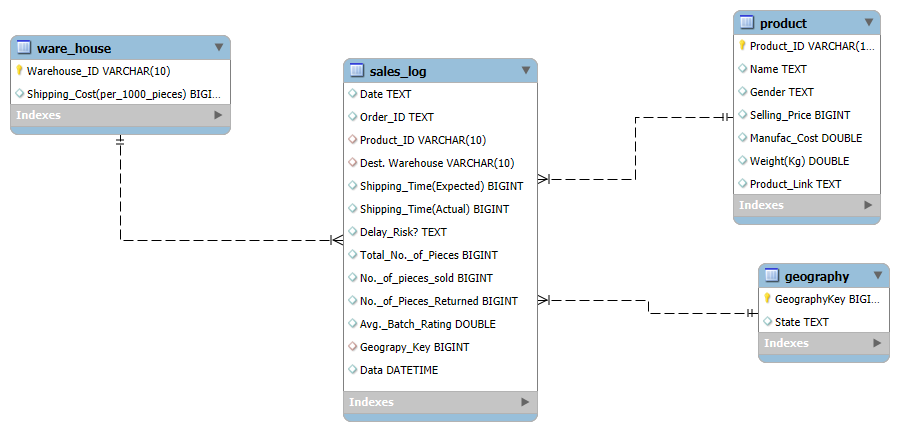 

### Data Modelling
The data sets create a star schema relationship consisting of a central sales table connected to dimensions table which are warehouse, product and geography.

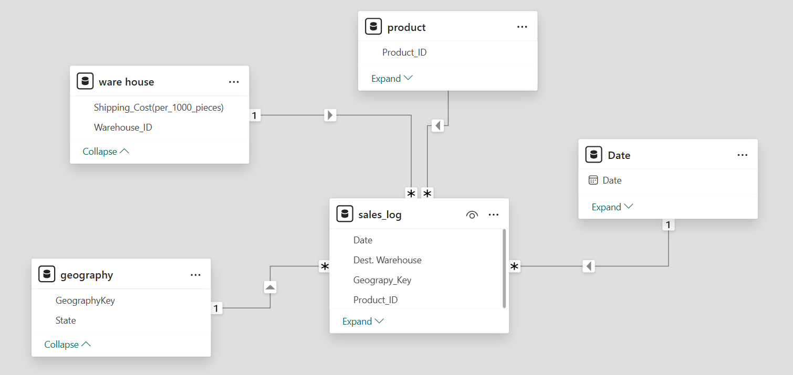)

## Data Analysis And Insight
### Product Sales Analysis

Men's Blazers, Men's Jacket & Men's Jens are the top the most sold product across all state generating over 120M which account for about 40% total sales.

#### Possible Factor ->

**Population & Urban lifestyle ->**  The state are urbanized by which it's driven more by metropolitan fashion and every day wear hence fashion clothes are the most sold compare to seasonal clothing
**Income & Office Culture ->** Higher concentration of professional workers may increase demand for blazers as part of business casual wardrobes
**MySQL Analysis Result (Filter by California)**
  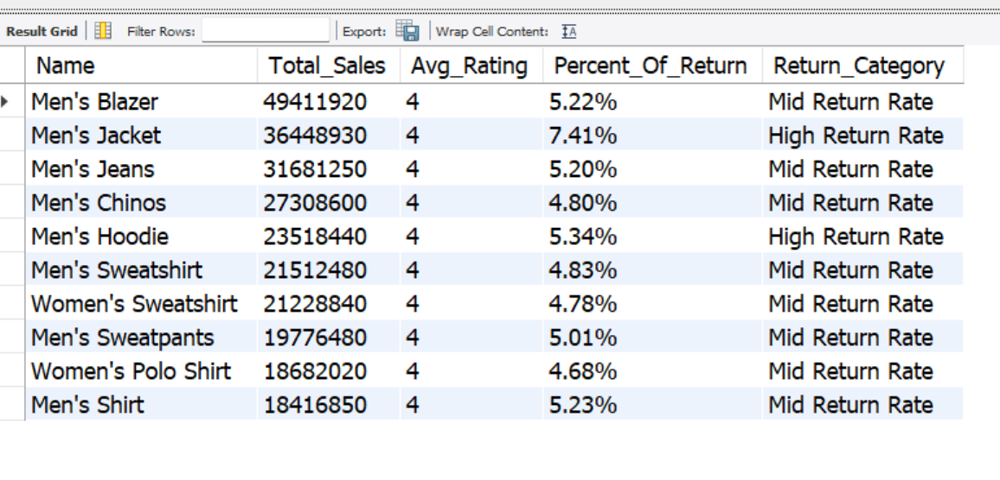

  
- Men's Tshirt, Men's Poloshirt, Men's Jeans, Men's Jacket and Mens's Shirt are the common most returned product with a return category between high return rate and critical return rate and despict Men's Tshirt, Men's Jeans, Men's Jacket and Mens's Shirt are among the top 10 Most sold clothe and strong customers ratings across all state they are still the most return prodoct, with illinois showing unusual high returns despite comparative lower sales  indicating a potential state specific fulfillment or customer behaviour issue that merits further investigation
  
#### possible factor -> 

**shipment delays ->** Men's Jacket, jeans, blazers, shirt  amongst other product as the highest delays risk of avg 3 days shipment delays
**Inconsistent post purchase issue ->** High customer ratings indicate product satisfaction, while high return volume suggest post purchases issue such as sizing, fit, rather than poor product quality
  
**MySQL Analysis Result (Filter by FLORIDA)**
  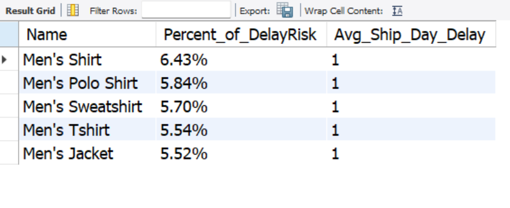
  
   
- Four of the five state generated the strongest revenue during Q2 ( may- June )and again in Q4 indicating recurring seasonal sales spike across the retail business. illinois generate one time sales surge in April but failed to sustain demand for the rest of the year , making it the only major state without a meaningful recovery after its peak month.
  
#### Possible factors ->

 **Seasonal Trend ->** With the most sold product being fashion and casual fit this only deduced that seasonal demand surge sales at mid year slow down then renew Q4 growth across most major state

**MySQL Analysis Result (Filter by FLORIDA)**
 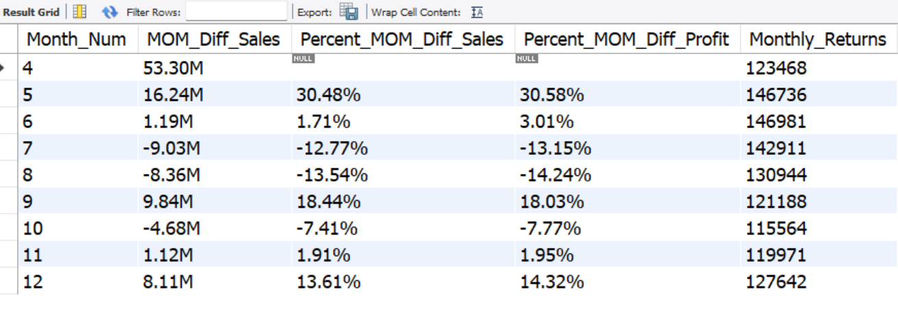
 
  
- All State has a no shipment delay of about 73% above 
  
**MySQL Analysis Result (Filter by FLORIDA)**
 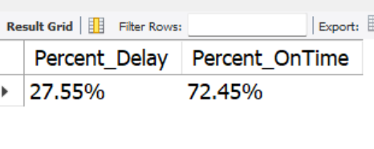  
  

  
**To interacte with the Iowa Sales Analysis In MySQL**
[Click Here](liquor_analysis.sql)

### Data Visualization

This visualization highlights key insights from the sales data, showcasing trends across products, counties, and stores. It provides a clear comparison of top-performing and low-performing categories, seasonal sales fluctuations, and revenue contributions. The analysis helps identify patterns in consumer demand and factors influencing sales performance.

**Sales Dashboard**


**Time Series Dashboard**


**Recommendation & Report Dashboard**


**To interacte with the Iowa Liquor Dashboard**
[Click Here](https://app.powerbi.com/groups/me/reports/21995906-657b-4704-9b00-44314d20f83b/8b551faf76e189e5424d?experience=power-bi)

### Video Of This Project
### [▶️ Watch Project Video on LinkedIn](https://www.linkedin.com/posts/victoryazubike_dataanalytics-dataprojects-datascience-activity-7355972871690633217-JMqm)

## Recommendation

- **Ensure Consistent Supply of High-Demand Products**
   Since American vodkas contribute the highest sales, maintaining stable inventory levels will prevent stockouts and meet customer demand. Temporary specials and cream       liquors should also be well-stocked during holiday periods to capitalize on seasonal spikes.

- **Strengthen Sales in Low-Performing Counties**
   Sales in counties like Fremont and Davis are significantly lower. Conducting targeted promotions, adjusting product selection, or improving store accessibility in these     areas could help increase sales.

- **Leverage Urban Market Growth**
   Polk County leads in sales due to its urbanization and high number of entertainment venues. Expanding distribution in similar high-density areas could further boost revenue.

- **Optimize Inventory and Marketing for Seasonal Trends**
   Sales increase during the fourth quarter, especially in December. Planning inventory and marketing campaigns around this trend can maximize revenue during peak periods.

- **Improve Store Placement for Higher Visibility**
   Sales data suggests that areas with more liquor stores generate higher revenue. Strategically placing new stores in high-traffic locations can further drive sales.

- **Use Data to Refine Sales Strategies**
   Regularly analyzing sales trends by product, county, and season can help optimize pricing, stock levels, and promotional efforts, ensuring a data-driven approach to    increasing revenue.


